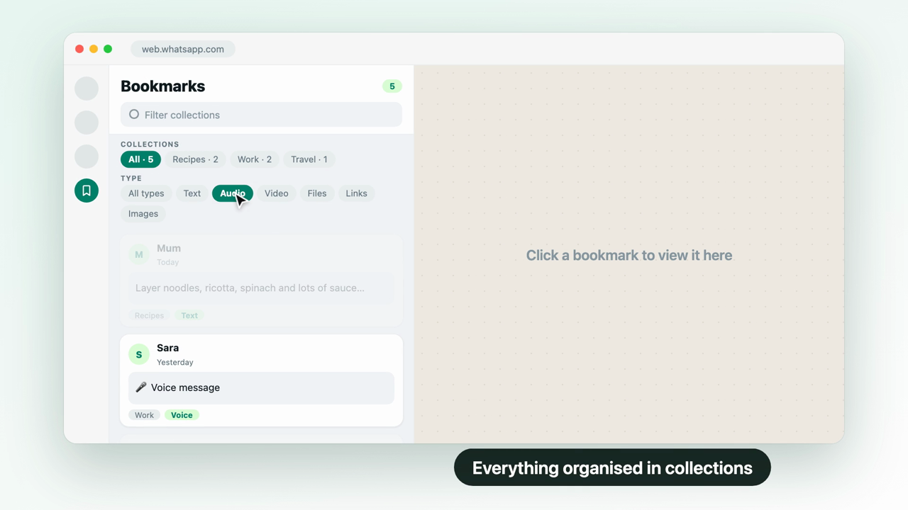
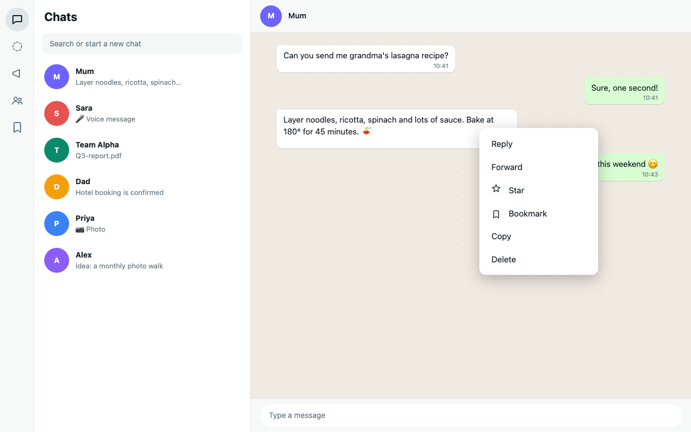
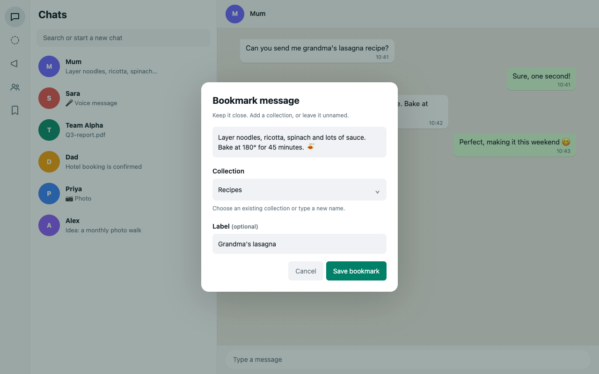
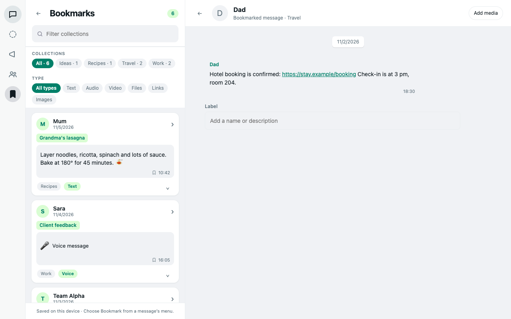
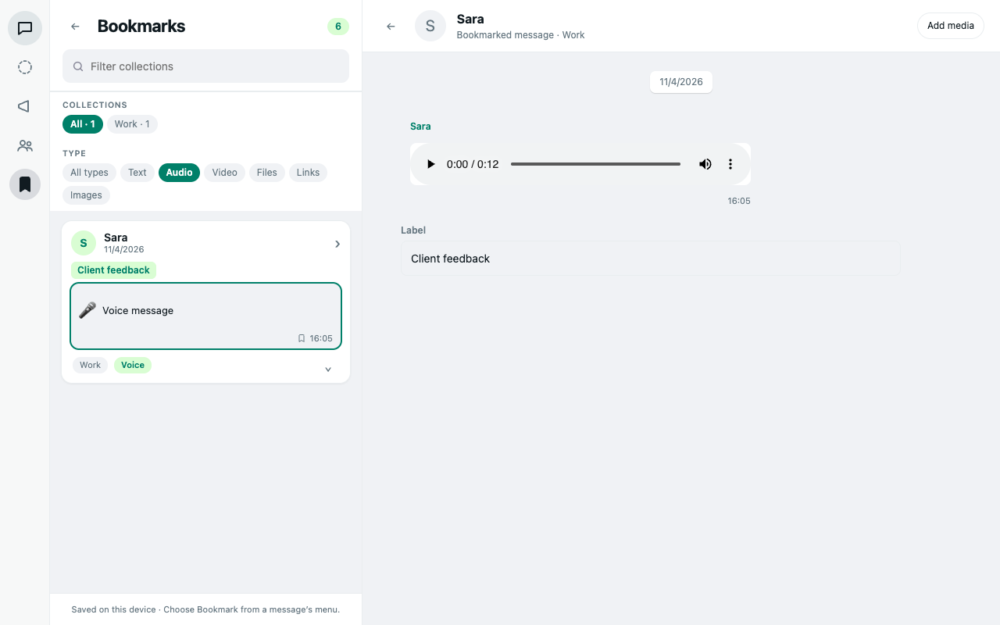
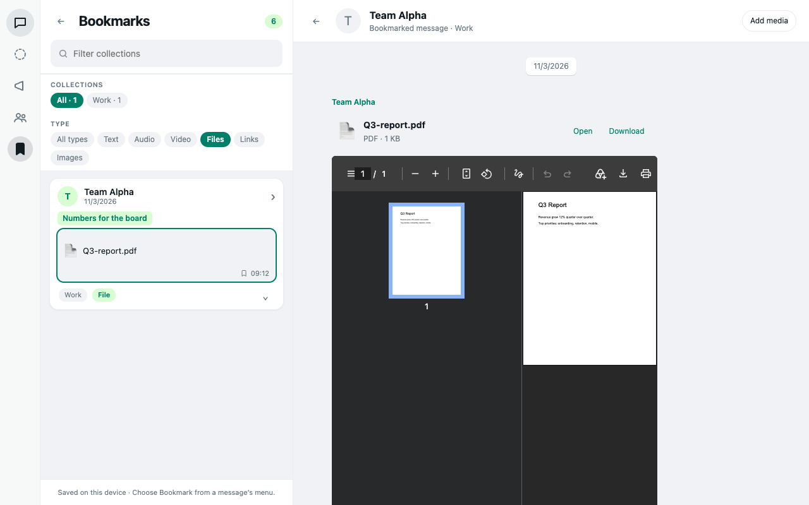
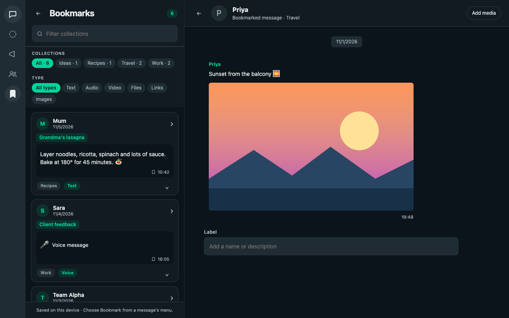

<p align="center"></p>

# WhatsApp Bookmarks

A Chrome extension that lets you save WhatsApp Web messages into named collections and open them later in a chat-style viewer. Text, voice notes, videos, images, shared contacts and files (PDF, Word, Excel and more) are all supported. Everything is stored on your device: there is no account, server, analytics or API key. The only network access is reading the media of a message you bookmark, from WhatsApp's own servers, exactly as WhatsApp Web itself would.

> Independent project. Not affiliated with, endorsed by, or sponsored by WhatsApp or Meta.

## Demo

<p align="center">
  <a href="store/whatsapp-bookmarks-promo.mp4"></a><br>
  <sub>▶ <a href="store/whatsapp-bookmarks-promo.mp4">Watch the 31-second demo</a></sub>
</p>

## Screenshots

All screenshots use invented chats and show the real extension UI.

| | |
| --- | --- |
| <br>**Bookmark from the message menu** | <br>**Save to a collection, add a label** |
| <br>**Browse, filter and open** | <br>**Play voice notes** |
| <br>**Open files and PDFs** | <br>**Follows light and dark themes** |

## Features

- **Bookmark from the native menu.** Open a message's menu (Reply, Forward, Star…) and choose **Bookmark**. It also works from WhatsApp's right-click menu, and Chrome's own context menu has **Bookmark this WhatsApp message** as a fallback.
- **Collections.** Pick an existing collection, type a new name, or leave it blank for **Unnamed**. Each bookmark can also carry one optional **Label** (a name or description).
- **A bookmarks pane beside your chats.** Click the bookmark icon in WhatsApp's left navigation (or the extension's toolbar button). Filter collections by name, and filter by type: Text, Audio, Video, Files, Links, Contacts, Images. Cards are a consistent size so the list is easy to scan.
- **A real viewer.** Click a card to open the full message in the right-hand pane:
  - text is selectable and copyable, and links open in a new tab;
  - voice notes and videos have full playback controls;
  - images open full size;
  - shared contacts show the name and phone number(s) in a card, with a **Copy number** button;
  - files show their name, type and size with **Open** and **Download**, and PDFs / plain text also render inline.
- **Move, relabel or remove** any bookmark from the card menu. Empty collections disappear automatically.
- **Matches WhatsApp.** The extension uses WhatsApp's own font and follows its light/dark theme, including live theme changes.

## Install

### From the Chrome Web Store
Search for **WhatsApp Bookmarks** once it is published, or use the link in the repository description.

### From source (developer mode)
1. Open `chrome://extensions`.
2. Turn on **Developer mode**.
3. Click **Load unpacked** and select this folder.
4. Open or refresh `https://web.whatsapp.com`.

Requires Chrome 111 or newer.

## Using it

1. Hover a message, open its menu and choose **Bookmark**.
2. Choose or type a collection, optionally add a label, and click **Save bookmark**.
3. For voice notes, videos and files, the extension copies the media while the dialog is open. **Save** becomes available when the copy is ready. If copying fails you can **Retry**, or **Save without the file** and attach it later with **Add media** in the viewer.
4. Open the bookmark icon in the left navigation to browse. Click a card to view it.

### Media notes

- Media is limited to 25 MB per attachment.
- Voice notes and videos are captured by briefly (and silently) playing the selected message; playback is restored afterwards. Videos can take up to a minute to download and decrypt.
- Files are captured by triggering WhatsApp's own download for that message; the extension reads the file instead of letting it reach your Downloads folder.
- Shared contacts are saved as a name and phone number(s); the number is read from the contact card WhatsApp Web has already loaded. If a card exposes no number, only the name is saved.
- View-once media is not supported. Full-resolution images may be unavailable, in which case a thumbnail is saved.
- If an older bookmark has no media bytes, re-bookmark the original message or use **Add media** in the viewer (image, audio, video or document, up to 25 MB).

## Privacy

Bookmarks live in the extension's local IndexedDB storage. Nothing is uploaded or synced, and the extension contacts no server of its own; the only requests it makes are to WhatsApp's media servers, to read a message you chose to bookmark. Uninstalling the extension or clearing its storage deletes your bookmarks, and other people using the same Chrome profile can see them. See [PRIVACY.md](PRIVACY.md) (or the hostable page [docs/privacy.html](docs/privacy.html)) for details and [STORE_LISTING.md](STORE_LISTING.md) for the permission justifications.

## Troubleshooting

- **No Bookmark button / icon after a WhatsApp update.** WhatsApp changes its page structure from time to time and the extension reads visible message containers, so selectors may need updating. Refresh the page first.
- **A voice note, video or file will not copy.** Keep the original message visible while the dialog is open, then **Retry**. Use **Copy debug info** in the dialog for a report of selector counts, controls found, a capture trace and player state. It contains no chat names, message contents, IDs or media bytes. If the clipboard is unavailable, a selected text box lets you copy it manually.
- **Save fails with a storage error.** Storage is unlimited for the extension, but the disk may be full.

## Development

No build step: the extension runs directly from source.

```sh
npm install        # installs linkedom for the DOM tests
npm test           # DOM regression suite
npm run check      # syntax check of every script
npm run icons      # regenerate PNG icons from the artwork (needs Pillow)
npm run package    # builds dist/whatsapp-bookmarks-<version>.zip for the Web Store
```

### Layout

| File | Purpose |
| --- | --- |
| `manifest.json` | Manifest V3 definition |
| `background.js` | Service worker: IndexedDB storage, context menu, toolbar button |
| `content.js` | UI (Shadow DOM), capture, viewer, filters |
| `content.css` | Styles for elements injected into WhatsApp's own DOM |
| `media-bridge.js` | Page-world script that observes native media/downloads **only** during a selected-message capture |
| `media.js` | Audio/video/document format sniffing and file reading |
| `navigation.js` | Message ID parsing |
| `assets/` | Logo (`icon.svg`) and generated PNG icons |
| `tests/` | DOM regression tests |

The tests cover native menus, collections, filters, saved text, images, audio, video, attaching missing media, viewer behaviour, theme changes and capture diagnostics. They run in a simulated DOM, so test real playback, downloads and layout in your signed-in WhatsApp Web session.

### Store screenshots
`promo/screens/` renders 1280×800 screenshots by running the real extension scripts in headless Chrome against a mock chat page (`mock.html`) seeded with invented bookmarks (`build-data.py`). Output goes to `store/screenshots/`.

```sh
python3 promo/screens/build-data.py                         # sample data (needs Pillow)
node promo/screens/render-screens.mjs store/screenshots     # Node 22+ and Google Chrome
```

### Promo video
`promo/promo.html` is a scripted, deterministic animation of the extension (open it in Chrome to watch it loop; Space pauses, arrow keys scrub). To render it to MP4 you need Node 22+, Google Chrome and an `ffmpeg`:

```sh
node promo/render.mjs /tmp/promo-frames 30 1.5      # 31 s of PNG frames at 1920x1080
ffmpeg -framerate 30 -i /tmp/promo-frames/frame_%04d.png -c:v libx264 -crf 18 -pix_fmt yuv420p promo/out/whatsapp-bookmarks-promo-silent.mp4
```
The soundtrack is an original, royalty-free track synthesised by `promo/music.py` (needs numpy), with soft click sounds timed to the cursor clicks. Mix it in with:

```sh
python3 promo/music.py /tmp/promo-music.wav
ffmpeg -i promo/out/whatsapp-bookmarks-promo-silent.mp4 -i /tmp/promo-music.wav -map 0:v -map 1:a -c:v copy -af "loudnorm=I=-16:TP=-1.5:LRA=7" -c:a aac -b:a 192k -shortest store/whatsapp-bookmarks-promo.mp4
```
Refresh `store/promo-poster.png` with `ffmpeg -ss 14.2 -i store/whatsapp-bookmarks-promo.mp4 -frames:v 1 -vf scale=1280:-1 store/promo-poster.png`. It uses a generic mock UI, not WhatsApp's branding or real chats.

### Releasing
1. Bump `version` in `manifest.json` and `package.json`, and the version string in the debug report in `content.js` (the regression test checks it).
2. Update [CHANGELOG.md](CHANGELOG.md).
3. `npm test && npm run package`, then upload the zip in the Chrome Web Store developer dashboard.
